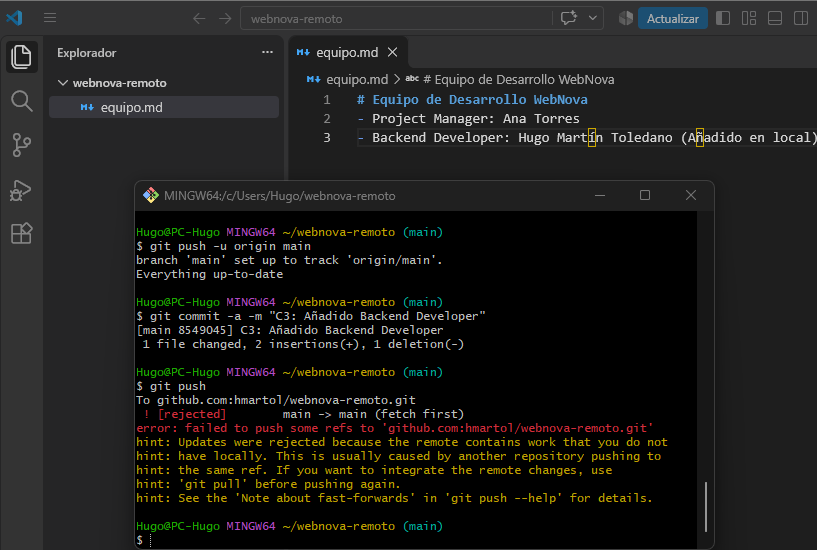
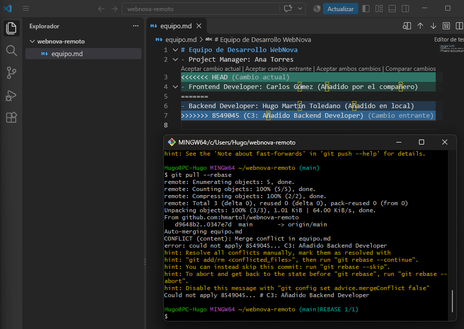
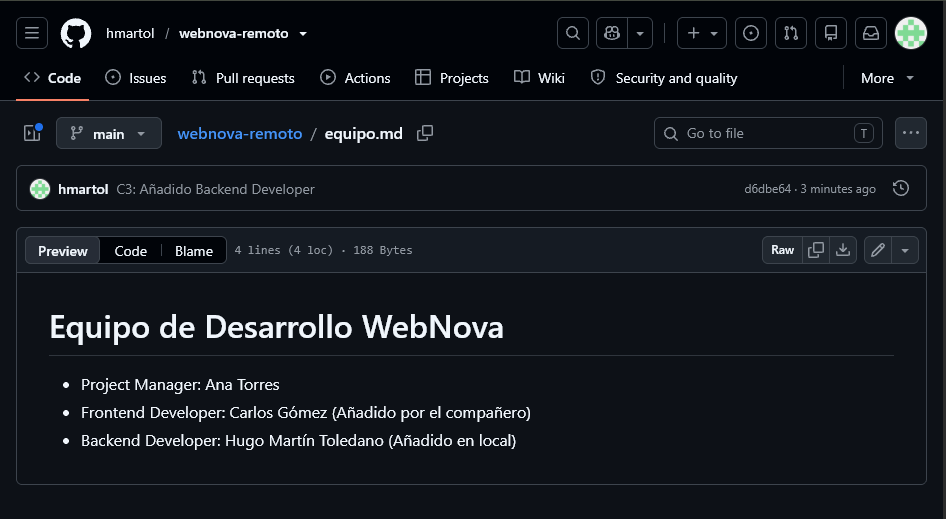

```markdown
# Práctica 5: Colaboración en GitHub y Resolución de Conflictos Remotos

**Hugo Martín Toledano - 2º DAW**

---

# Fase 1: Preparación

He creado el repositorio `webnova-remoto`, el archivo `equipo.md` y lo he conectado con GitHub.

---

# Fase 2: Cambio desde GitHub

He editado `equipo.md` directamente desde GitHub para simular el trabajo de otro compañero y he añadido a Carlos como Frontend Developer.

---

# Fase 3: Cambio local y error al subir

Después he añadido mi cambio desde el ordenador y he intentado subirlo a GitHub.

Git ha rechazado el `push` porque en GitHub ya había cambios que mi repositorio local todavía no tenía.



La palabra que aparece en el error es `rejected`. Git indica que primero tengo que traer los cambios que ya existen en el repositorio remoto.

---

# Fase 4: Resolución del conflicto

He usado `git pull --rebase` para traer los cambios de GitHub.

Como los dos cambios estaban hechos en la misma parte del archivo, apareció un conflicto.



He quitado las marcas del conflicto y he dejado los tres miembros en `equipo.md`.

Después he continuado el `rebase` y he vuelto a hacer `push`.

---

# Resultado final

El archivo final aparece correctamente en GitHub con Ana, Carlos y Hugo.



---

# Reflexión

Git bloqueó la subida porque en GitHub había un cambio nuevo que yo todavía no tenía en mi ordenador.

Con `git pull --rebase` pude traer primero ese cambio y después añadir el mío encima. Así el historial queda más ordenado y no se crea otro commit solo para juntar los cambios.
```